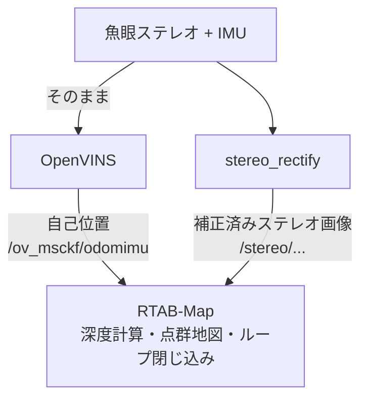

# photogrammetry

魚眼ステレオカメラ＋IMUを用いた、自己位置推定（VIO）とマッピングの実験用ワークスペースです。
自己位置推定には OpenVINS、地図生成とループ閉じ込みには RTAB-Map を使い、魚眼画像をステレオ深度計算用に補正するノードを自作しています。

## 仕組み




- **OpenVINS**: 魚眼画像とIMUから、カメラ（ロボット）の位置と向きを推定する
- **stereo_rectify**: 魚眼画像を、左右が平行に並んだ普通のカメラの画像に変換する（ステレオで距離を計算するため）
- **RTAB-Map**: 補正画像から距離を計算し、OpenVINSの位置を使って点群の地図を積み上げる

## 全体の入出力

### 入力

| 種類 | トピック | 型 | 備考 |
| --- | --- | --- | --- |
| 左カメラ画像 | `/cam0/image_raw` | `sensor_msgs/Image` | 魚眼。トピック名は `kalibr_imucam_chain.yaml` の `rostopic` |
| 右カメラ画像 | `/cam1/image_raw` | `sensor_msgs/Image` | 同上 |
| IMU | `/imu0` | `sensor_msgs/Imu` | 100〜200Hz程度。トピック名は `kalibr_imu_chain.yaml` の `rostopic` |
| 時刻 | `/clock` | `rosgraph_msgs/Clock` | bag再生時のみ（`ros2 bag play --clock`） |

画像とIMUのタイムスタンプは、同じ時計で付いている必要があります。

設定ファイル（`my_vio_bringup/config/<robot>/`）:

- `estimator_config.yaml`: OpenVINSの推定器の設定
- `kalibr_imucam_chain.yaml`: カメラの内部パラメータ、カメラとIMUの位置関係（OpenVINSと`stereo_rectify`が共有）
- `kalibr_imu_chain.yaml`: IMUのノイズ特性

### 出力

**自己位置（OpenVINS）**

| トピック | 型 | 内容 |
| --- | --- | --- |
| `/ov_msckf/odomimu` | `nav_msgs/Odometry` | 自己位置と速度（IMUのレート、約200Hz） |
| `/ov_msckf/poseimu` | `geometry_msgs/PoseWithCovarianceStamped` | 自己位置（カメラのレート） |
| `/ov_msckf/pathimu` | `nav_msgs/Path` | 推定軌跡 |
| `/ov_msckf/points_msckf` | `sensor_msgs/PointCloud2` | 推定に使っている特徴点 |
| `/ov_msckf/trackhist` | `sensor_msgs/Image` | 特徴点の追跡の様子 |

**補正画像（stereo_rectify）**

| トピック | 型 | 内容 |
| --- | --- | --- |
| `/stereo/{left,right}/image_rect` | `sensor_msgs/Image` | 平行ステレオに補正した画像 |
| `/stereo/{left,right}/camera_info` | `sensor_msgs/CameraInfo` | 補正後の仮想カメラの情報 |

**地図（RTAB-Map、`use_rtabmap:=true`のとき）**

| トピック | 型 | 内容 |
| --- | --- | --- |
| `/rtabmap/cloud_map` | `sensor_msgs/PointCloud2` | 点群地図 |
| `/rtabmap/map` | `nav_msgs/OccupancyGrid` | 2Dの占有格子地図 |
| `/rtabmap/mapGraph` | `rtabmap_msgs/MapGraph` | キーフレームの位置のグラフ |

地図のデータベースは `~/.ros/rtabmap.db` に保存されます（`--delete_db_on_start` により起動のたびに初期化）。

### TF（座標系のつながり）

```text
map ──→ global ──→ imu ──→ cam0 ──→ cam0_rect
 │        │          └──→ cam1
 │        └ OpenVINS（自己位置）
 └ RTAB-Map（ループ閉じ込みによる補正）

imu → cam0, cam1 : OpenVINS（キャリブレーション値）
cam0 → cam0_rect : stereo_rectify（静的）
```


## ディレクトリ構成

```text
photogrammetry/                 # このリポジトリ（＝ROS 2ワークスペース）
├── README.md
├── .gitignore
├── .gitmodules                 # サブモジュールの設定（自動生成）
└── src/
    ├── open_vins/              # OpenVINS本体（サブモジュール）
    ├── my_vio_tools/           # 自作ノード
    │   └── my_vio_tools/
    │       └── stereo_rectify_node.py
    └── my_vio_bringup/         # 設定とlaunchファイル
        ├── launch/
        │   └── vio.launch.py
        └── config/
            └── tum_vi/         # TUM VIデータセット用の設定
```

| パッケージ | 役割 |
| --- | --- |
| `open_vins` | 自己位置推定（外部リポジトリ。サブモジュールとして取り込み、中身は編集しない） |
| `my_vio_tools` | 自作ノード。魚眼ステレオ画像を補正する `stereo_rectify` |
| `my_vio_bringup` | 設定ファイル（`config/`）と、全体をまとめて起動する launch ファイル（`launch/`） |

`build/`、`install/`、`log/` はビルドで生成されるため、リポジトリには含めません。

## 動作環境

- Ubuntu 22.04
- ROS 2 Humble
- 表示: Lichtblick（foxglove_bridge 経由で接続）

## セットアップ

### 1. リポジトリを取得する

サブモジュール（OpenVINS）も一緒に取得するため、`--recursive` を付けて clone します。

```bash
git clone --recursive <このリポジトリのURL> ~/wrs/photogrammetry
```

`--recursive` を付け忘れた場合は、clone した後に次を実行します。

```bash
cd ~/wrs/photogrammetry
git submodule update --init --recursive
```

### 2. 依存パッケージを入れる

各パッケージの `package.xml` に書かれた依存（RTAB-Map、foxglove_bridge、OpenCV など）を、rosdep がまとめて apt で入れます。

```bash
cd ~/wrs/photogrammetry
source /opt/ros/humble/setup.bash
sudo rosdep init   # PCで初めて使うときだけ
rosdep update
rosdep install --from-paths src --ignore-src -y
```

サンプルキャリブレーションデータをOpenVINSからmy_vio_bringupにコピーし、ここから参照するようにする。

```bash
cd ~/wrs/photogrammetry
cp -r src/open_vins/config/tum_vi src/my_vio_bringup/config/
```

### 3. ビルドする

```bash
cd ~/wrs/photogrammetry
export MAKEFLAGS="-j1"   # OpenVINSのビルドはメモリを大量に使うため並列数を絞る
colcon build --symlink-install --executor sequential
source install/setup.bash
```

- OpenVINS のビルドには数分〜十数分かかります。メモリに余裕があれば `-j2` 以上にすると速くなります。
- `--symlink-install` を付けているので、既存の yaml や launch ファイルを書き換えたときはビルドし直さなくても反映されます。新しいファイルを追加したときは、ビルドし直してください。

### 4. 新しいターミナルを開くたびに

```bash
source /opt/ros/humble/setup.bash
source ~/wrs/photogrammetry/install/setup.bash
```

## TUM VI データセットで試す

### 1. データを用意する

[TUM VI データセット](https://cvg.cit.tum.de/data/datasets/visual-inertial-dataset) から `dataset-room1_512_16.bag` をダウンロードし、ROS 2 形式に変換します。

```bash
pip install rosbags
rosbags-convert --src dataset-room1_512_16.bag --dst room1
```

ダウンロードが途中で切れていると変換時に `Bag index looks damaged` というエラーになります。その場合は `wget -c <URL>` で落とし直してください。

### 2. 実行する

ターミナル1: OpenVINS + 補正ノード + foxglove_bridge + RTAB-Map

```bash
ros2 launch my_vio_bringup vio.launch.py
```

bagを再生するときは `use_sim_time:=true` を付ける

```bash
ros2 launch my_vio_bringup vio.launch.py use_sim_time:=true
```

ターミナル2: データ再生（`--clock` でbagの時刻を配信する）

```bash
ros2 bag play room1 --clock
```

ターミナル3:foxglove_brige起動
```bash
ros2 launch foxglove_bridge foxglove_bridge_launch.xml
```

【備考】OpenVINS + 補正ノード + foxglove_bridge（RTAB-Mapなし、自己位置推定のみ）

マッピングをなしにするなら `use_rtabmap:=false` を付けます。

```bash
ros2 launch my_vio_bringup vio.launch.py use_rtabmap:=false
```

OpenVINS はデータを最初から流し直しても状態がリセットされないため、もう一度試すときはターミナル1も起動し直してください。

### 3. Lichtblick で表示する

「Open connection」→「Foxglove WebSocket」→ `ws://localhost:8765` に接続し、パネルを追加します。
3Dパネルのトピックは、パネル右上の歯車アイコン →「Topics」で表示を切り替えます。

| 表示したいもの | パネル | トピック | Display frame |
| --- | --- | --- | --- |
| 推定軌跡 | 3D | `/ov_msckf/pathimu` | `global` |
| 特徴点 | 3D | `/ov_msckf/points_msckf` | `global` |
| 点群地図 | 3D | `/rtabmap/cloud_map` | `map` |
| 特徴点の追跡 | Image | `/ov_msckf/trackhist` | - |
| 補正画像（左右） | Image | `/stereo/left/image_rect`, `/stereo/right/image_rect` | - |

補正が正しければ、左右の補正画像で同じ物体が同じ高さに写ります。

## launch 引数（vio.launch.py）

`ros2 launch my_vio_bringup vio.launch.py 引数名:=値` の形で指定します。

| 引数 | デフォルト | 説明 |
| --- | --- | --- |
| `robot` | `tum_vi` | 使う設定フォルダ（`my_vio_bringup/config/<robot>/`） |
| `use_rtabmap` | `true` | RTAB-Map を起動するか |
| `use_sim_time` | `false` | bagの時刻で動かすか（bag再生時は `true`、実機では `false`） |

## stereo_rectify ノード

### パラメータ

| パラメータ | デフォルト | 説明 |
| --- | --- | --- |
| `calib_file` | （必須） | OpenVINS 形式の `kalibr_imucam_chain.yaml` のパス（launch ファイルが自動で渡す） |
| `left_cam` / `right_cam` | `cam0` / `cam1` | yaml 内のカメラ名 |
| `balance` | `0.0` | 0: 余白なし（視野は狭い）〜 1: 視野を広く（余白あり） |
| `fov_scale` | `1.0` | 補正後の視野の倍率 |
| `output_prefix` | `/stereo` | 出力トピックの接頭辞 |
| `imu_frame` / `cam_frame` / `rect_frame` | `imu` / `cam0` / `cam0_rect` | TF の座標系名 |
| `publish_imu_to_cam_tf` | `false` | `imu`→`cam0` の TF を自分で出すか（他から出ていない場合のみ `true`） |

### 入出力

- 入力: 左右の魚眼画像（トピック名は `calib_file` 内の `rostopic` から読む）
- 出力:
  - `/stereo/left/image_rect`, `/stereo/left/camera_info`
  - `/stereo/right/image_rect`, `/stereo/right/camera_info`
  - TF: `cam0` → `cam0_rect`（静的）

起動時のログに表示される「基線長」が、実際の左右カメラの間隔と一致しているかを確認してください（TUM VI では約10cm）。

## 自分のロボットで使う

1. `src/my_vio_bringup/config/tum_vi` をコピーして `src/my_vio_bringup/config/<ロボット名>` を作る
2. `kalibr_imucam_chain.yaml` を、自分のカメラで [Kalibr](https://github.com/ethz-asl/kalibr) を使って求めた値に書き換える（カメラモデルは `pinhole-equi`）
3. `kalibr_imu_chain.yaml` に、自分の IMU のノイズ特性とトピック名を書く
4. `estimator_config.yaml` のカメラ台数（`max_cameras`）などを合わせる
5. `colcon build --symlink-install --packages-select my_vio_bringup` でビルドし直す（新しいファイルを追加したため）
6. `ros2 launch my_vio_bringup vio.launch.py robot:=<ロボット名>` で起動する

## OpenVINS のバージョン

OpenVINS はサブモジュールとして、特定のコミットに固定されています。現在のコミットは次で確認できます。

```bash
git submodule status
```

更新する場合:

```bash
cd src/open_vins
git pull
cd ../..
git add src/open_vins
git commit -m "Update OpenVINS"
```

更新後は OpenVINS のビルドし直しが必要です。

## トラブルシューティング

| 症状 | 確認すること |
| --- | --- |
| ビルド中にPCが固まる | `MAKEFLAGS="-j1"` と `--executor sequential` を付ける。スワップを増やす |
| `src/open_vins` が空 | clone 時に `--recursive` を付け忘れている。`git submodule update --init --recursive` |
| OpenVINS が起動しない | `config_path` のファイルが存在するか（`ros2 launch` のログを確認） |
| RTAB-Map が TF を見つけられない | `ros2 run tf2_tools view_frames` で `imu`→`cam0`→`cam0_rect` がつながっているか。なければ `publish_imu_to_cam_tf` を `True` に |
| 補正画像の左右で高さがずれる | キャリブレーションの値、`T_imu_cam` の向き |

## ライセンス

- 自作コード（`my_vio_tools`、`my_vio_bringup` の launch ファイル）: MIT
- OpenVINS: GPL-3.0（サブモジュールとして参照）
- `src/my_vio_bringup/config/tum_vi/` は OpenVINS 同梱の設定ファイルをコピーしたものです（GPL-3.0）。